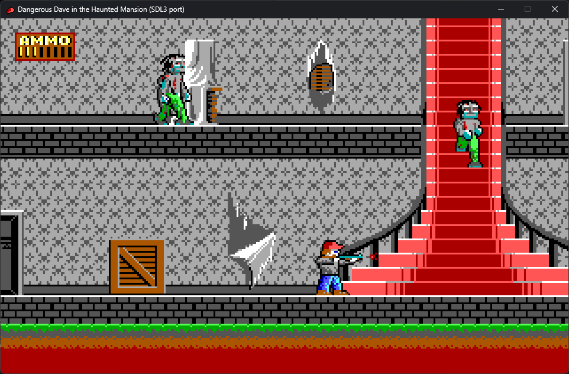

# Dangerous Dave in the Haunted Mansion — SDL3 port



A C + SDL3 source port of Dangerous Dave in the Haunted Mansion (id Software /
Softdisk, 1991). The game logic is reconstructed from the disassembly of the
original DOS binary, and that disassembly is the reference for the port's
behaviour and for the automated checks. It renders the original EGA 320×200
graphics and plays the original PC-speaker sound.

## What you need to run it

**1. The original game data** (not part of this repository) — put these files in
one directory:

```
EGATILES.DD2   LEVEL01.DD2 … LEVEL08.DD2
S_DAVE.DD2  S_CHUNK1.DD2  S_CHUNK2.DD2  S_FRANK.DD2  S_MASTER.DD2
INTRO.DD2  STARPIC.DD2  PROGPIC.DD2  TITLE1.DD2  TITLE2.DD2
```

`DAVE2.EXE` is not needed: the sprite size table, the actor-info records and the
tile attributes are compiled into `src/dd2_sprtable.h`, `src/dd2_actorinfo.h`
and `src/dd2_tileattr.h`.

**2. A built port** (see below), i.e. `dd2` or `dd2.exe`.

## Building

### Linux / macOS

You need a C compiler (gcc or clang), `make` and **SDL3** (3.x, headers and
library).

```sh
make                                    # looks for SDL3 in re/third_party/sdl3-install,
                                        # ../re/third_party/sdl3-install,
                                        # /mnt/c/Games/DD2/re/third_party/sdl3-install
make SDL3_PREFIX=/path/to/sdl3-install  # if SDL3 lives somewhere else
```

### Windows (MSVC 2022+)

```bat
msvc\build.bat [Release|Debug] [x64|x86]
```

The script locates Visual Studio itself and downloads SDL3 if it is missing
(`msvc\fetch_sdl3.ps1`). The result is `bin\Release\dd2.exe` with `SDL3.dll`
next to it. A mingw-w64 build also works:
`make CC=gcc WINDRES=windres dd2_res.o`.

## Running

```sh
./dd2 /path/to/data                  # Linux
bin\Release\dd2.exe C:\Games\DD2     # Windows
```

With no argument the port looks for the data in the current directory, `./data`
and `../re/ref/orig`.

## Controls

| Action | Keys |
|---|---|
| move | arrow keys or numpad 8/9/6/3/2/1/4/7 (diagonals: 9/3/1/7) |
| jump | CTRL |
| fire | ALT |
| start from the title | SPACE |
| status window | TAB |
| F1 / F2 / F3 / F4 / F5 | information / sound on-off / keyboard setup / gamepad / reset game |
| quit | ESC |

An SDL gamepad is picked up automatically; the input mode and buttons are
configured through F4.

## Checks

```sh
make check    # sweep   -- walks all 8 levels with scripted input
              # flow    -- lives, deaths, game over, restarts, score
              # startest -- star-engine tables, spans and logo drawing (exact)
```

## Layout

```
src/      game logic and platform layer (original addresses in the comments)
tests/    automated tests: sweep, flow, startest, hitprobe
msvc/     Visual Studio project and build.bat
specs/    architecture, port plan, procedure coverage map
tools/    icon and UI-bank generators
re/       reverse-engineering workspace: the disassembler
          re/tools/dd2dis_cli.py, the reference image DAVE2_IMAGE.bin, DOSBox-X
          comparisons and the audit notes (not part of the repository, see
          .gitignore)
```

## License

The port's code is CC0 1.0 (see `LICENSE`). The original game data is not
covered by it and is not distributed here.
